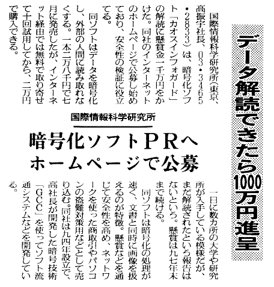

# GCC-Chaos-Contest

国際情報科学研究所（IISI）が開発したGCCカオス暗号の、賞金一千万円の懸賞問題をこのたび~~Mythosが~~解読しました！

## GCC (Gao's Chaos Cryptosystem)

GCCカオス暗号は、国際情報科学研究所の高振宇（Gao Zhenyu）社長が開発した、カオス関数を利用する共通鍵型のストリーム暗号です。カオスの「初期値に敏感に依存する」「予測できない」といった性質を鍵ストリームの生成に利用しており、任意長の鍵を扱えることを特長として謳っていました。

## 懸賞コンテスト

1996年頃、IISI は GCC 暗号で暗号化した暗号文を同梱したカオスインフォガードを自社のホームページや CD-ROM で公開・配布し、最初に解読した人に懸賞金一千万円を支払うと発表しました。



30年も前の話ですが、解いた人がいるという話はいまだに聞かないので、私が一番乗りだと思います。

なお、コンテストは1997年12月31日に終了しています。

## リポジトリの構成

```
.
├── image/        新聞記事の画像
├── software/     IISI が配布していたカオスインフォガード
└── writeup/      暗号文・平文・鍵・解読の記録（ネタバレ）
    ├── ciphertext/   暗号文
    ├── plaintext/    解読した平文
    ├── password/     解読で得た鍵
    ├── docs/         暗号の仕様、解読のライトアップ、パスワード復元の記録
    └── src/          暗号の再実装、解読とパスワード復元に使ったコード
```

各ファイルの SHA-256 チェックサムは、それぞれのディレクトリの `sha256sum.txt` に記載しています。

## 自力で解きたい方へ

[writeup/](writeup/) ディレクトリには、平文や鍵といったコンテストのネタバレが含まれています。問題は [software/](software/) にある配布ソフトだけで解けるので、自力で挑戦したい方は writeup/ を開かないようにしてください。

## ライセンス

このリポジトリの成果物は [The Unlicense](LICENSE) のもと、パブリックドメインで公開しています。

ただし、[software/](software/) 内のプログラムの著作権は元の配布元に帰属しており、その条件に従って再配布しています。詳しくは [software/LICENSE.md](software/LICENSE.md) を参照してください。
